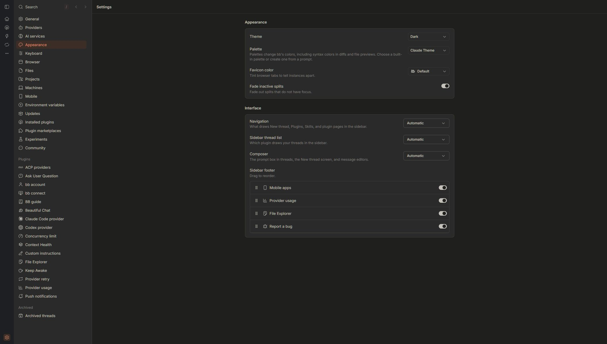
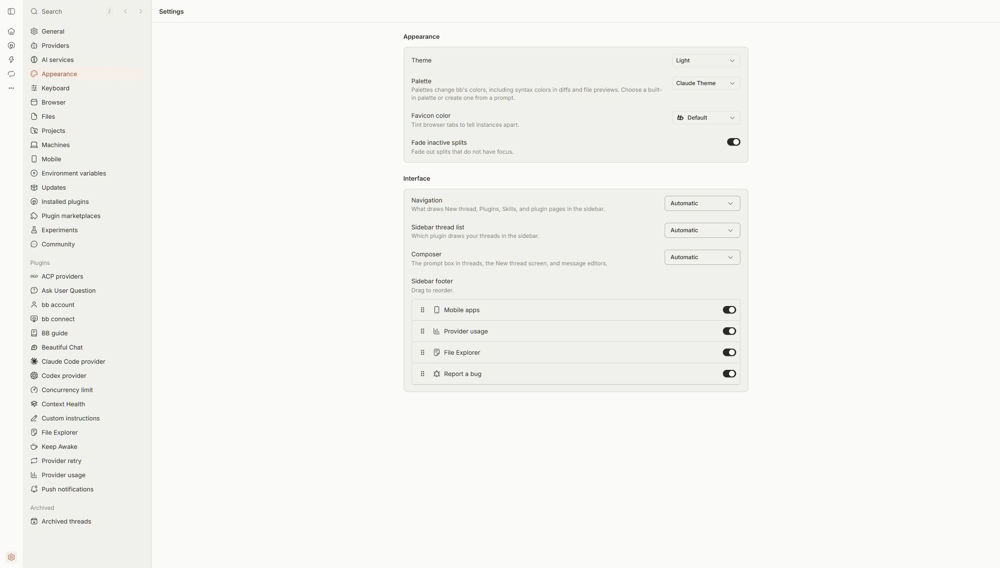

# Claude Theme for BB

Terracotta accents with charcoal dark and off-white light palettes. An independent BB adaptation of **Claude Theme for VS Code by SK**, version **3.1.0**.

## Install

```sh
bb plugin install "git:https://github.com/Treo-Solutions/bb-plugin-claude-theme.git@v0.1.0"
```

This installs the exact tagged release `v0.1.0`. The command works in Command Prompt, PowerShell and POSIX shells without relying on caret escaping.

In **Settings → Appearance**, select **Claude Theme** under Palette. Choose **Light**, **Dark** or **System** under Theme. System follows the operating system's preferred appearance. From the CLI:

```sh
bb theme set plugin:claude-theme:claude-theme
```

Requires BB **0.47.1 or later, below 1.0**, with Plugin SDK **0.6.79 or later, below 0.7**. No account or external service is required. The source VS Code extension does not need to be installed.

Git must be available on the machine running BB to install from GitHub.

## Dark



## Light



## Colours

Dark mode uses warm charcoal surfaces, beige text and terracotta accents. Light mode uses off-white surfaces, charcoal text and darker terracotta accents. Both include tinted hover and selection backgrounds, terracotta selected navigation labels and icons, and an underline on active tabs.

Code previews and diffs use SK's original syntax files: **106 dark rules** and **94 light rules**, copied unchanged. Each mode maps its source's 16 terminal colours to BB's ANSI tokens. Fonts and layout use BB defaults.

The BB adaptation uses more readable low-emphasis labels, weaker selection tints in light mode, and SK's darker light-mode button colour to keep white labels above 4.5:1 contrast. Active-state styles target BB's native tab and current-page attributes; plugins with custom navigation may expose different states. The Warm variants are not included.

## Development

Run from a clone of this repository:

```sh
npm ci --include=dev --ignore-scripts
npm run typecheck
bb plugin build
bb plugin install .
```

The plugin declares only a palette, CSS and code-colour files. Its required server factory is empty. It adds no background tasks, network calls, agent tools or settings.

## Attribution and licence

Original theme: [Claude Theme for VS Code by SK](https://github.com/sathishsk-me/claude-vscode-theme), by **S K 🦊**, MIT. This independent adaptation is maintained by [Treo-Solutions](https://github.com/Treo-Solutions); it is not an official Anthropic product.

The original copyright and complete MIT licence are preserved in [LICENSE](LICENSE). See [THIRD_PARTY_NOTICES.md](THIRD_PARTY_NOTICES.md) for the source version and checksums.
